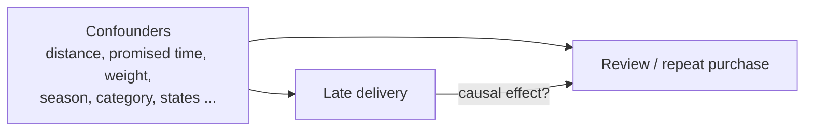
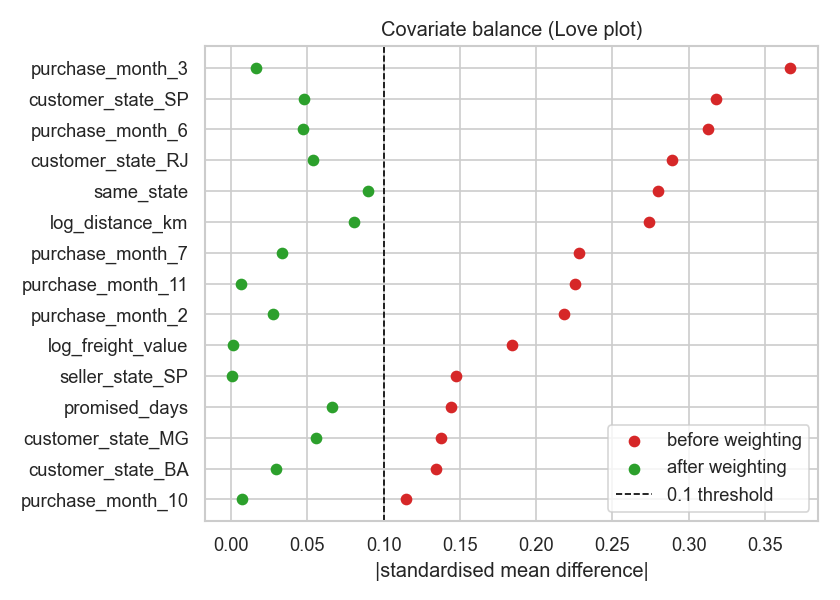
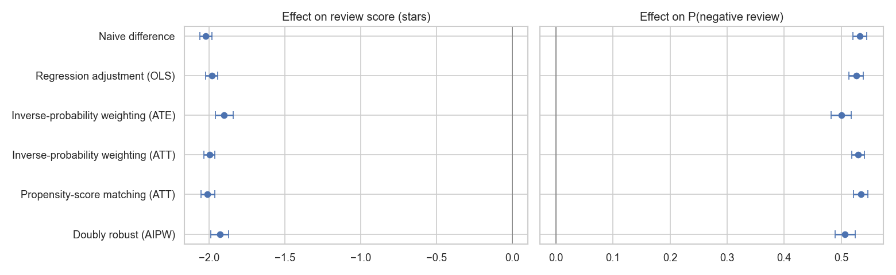

# 🚚 Causal Inference: does a late delivery *cause* bad reviews and lost customers?

On an e-commerce marketplace, late orders get far worse reviews — but late orders are also **different before anything goes wrong** (farther away, heavier, shorter promised times, busy seasons). This project uses **causal inference on observational data** to separate causation from correlation on **95,333 real orders** from Olist.


📓 **Full report:** [`notebooks/late_delivery_causal.ipynb`](notebooks/late_delivery_causal.ipynb)

## Setup

| | |
|---|---|
| **Unit** | one delivered order (95,333; 6.6% late) |
| **Treatment** | delivered after the date promised to the customer |
| **Outcomes** | review score (1–5), negative review (1–2★), repeat purchase within 6 months (first orders) |
| **Confounders** | only what is known **at purchase time**: distance, promised delivery time, weight, volume, price, freight, items, payment, instalments, month, weekday, category, customer & seller state |



## Methods

Six estimators, from naive to doubly robust, so the answer does not depend on one modelling choice:

1. **Naive difference** in means (confounded)
2. **Regression adjustment** — OLS with robust standard errors
3. **Inverse-probability weighting** (ATE and ATT) — propensity scores from logistic regression
4. **Propensity-score matching** (ATT) — 1:1 nearest neighbour with a caliper
5. **Doubly robust AIPW** — correct if *either* the outcome or the propensity model is right; influence-function standard errors
6. **Sensitivity analysis** — the **E-value** for unmeasured confounding

The estimators are **tested on simulated data with a known effect**, where the naive comparison even gets the sign wrong — all adjusted estimators recover the truth (`tests/`).

## Results

**Are late orders different?** Yes: before adjustment **20 confounders** are imbalanced (|standardised mean difference| > 0.1, max 0.37). Late orders travel farther, got *shorter* promised times, and cluster in busy months — up to **19% of March 2018 orders** were late vs ~7% overall. After inverse-probability weighting, **0** confounders are imbalanced (max 0.09).



**Effect of a late delivery on reviews** — every method agrees:

| Method | Review score (stars) | P(negative review) |
|---|---|---|
| Naive difference | −2.02 | +53.2 pp |
| Regression adjustment | −1.98 | +52.6 pp |
| IPW (ATE) | −1.90 | +50.0 pp |
| IPW (ATT) | −2.00 | +52.9 pp |
| Propensity matching (ATT) | −2.01 | +53.4 pp |
| **Doubly robust (AIPW)** | **−1.93** [−1.99, −1.87] | **+50.6 pp** [+48.9, +52.4] |

A late delivery lowers the review by **about 2 stars** and multiplies the chance of a negative review by **about 6.5** (9% → 60%). The adjusted estimates are close to the naive one: the confounders strongly predict *whether* an order is late but barely affect the review directly — so here the correlation is almost entirely causal, which the analysis had to *show*, not assume.



**How late matters** (adjusted, vs on-time orders):

| Days late | 1–3 | 4–7 | 8–14 | 15+ |
|---|---|---|---|---|
| Review change | **−0.99** | −2.17 | −2.58 | −2.51 |

Even 1–3 days late costs about **one star**; the damage levels off after about two weeks.

**Robustness:** E-value ≈ **12.4** — an unmeasured confounder (say, an unreliable seller who is both slow and ships poor products) would need a risk ratio of ~12 with *both* lateness and negative reviews to explain the effect away.

**Repeat purchases:** naively, customers whose first order was late are 0.53 pp less likely to buy again within 6 months (just significant). After adjustment the estimates shrink (AIPW −0.46 pp, matching +0.14 pp) and **every confidence interval includes zero**. With a 2.9% repeat rate, the data can neither confirm nor rule out a moderate effect — **no reliable evidence either way**.

## Business implication

**Keeping the promise matters more than speed.** Customers judge the delivery against the date they were given, and even a few days late costs a star. Realistic delivery estimates — especially for distant customers and in peak months — plus proactive delay warnings are the lever.

## Limitations

Seller identity and quality are only partly captured (seller state); reviews come from customers who chose to write them; the repeat-purchase window is limited by the dataset's end date.

## Run it

The data comes from the star-schema warehouse built by my [E-commerce Data Pipeline](https://github.com/Ananya2029/ecommerce-data-pipeline) (Olist). Build it there (`python -m pipeline.run`), or set `WAREHOUSE_PATH`.

```bash
pip install -r requirements.txt
python build_notebook.py     # rebuilds and executes the report, writes reports/
python -m pytest -q          # estimators recover a known effect on simulated confounded data
```

## Project structure

```text
├── causal/
│   ├── data.py          # analysis table from the warehouse (pre-treatment confounders only)
│   └── estimators.py    # naive, OLS, IPW, matching, AIPW, balance (SMD), E-value
├── build_notebook.py
├── notebooks/late_delivery_causal.ipynb
├── reports/             # charts + results.json
└── tests/
```

## Tech stack

Python · pandas · NumPy · statsmodels · scikit-learn · DuckDB · Matplotlib · Seaborn · Jupyter · pytest
